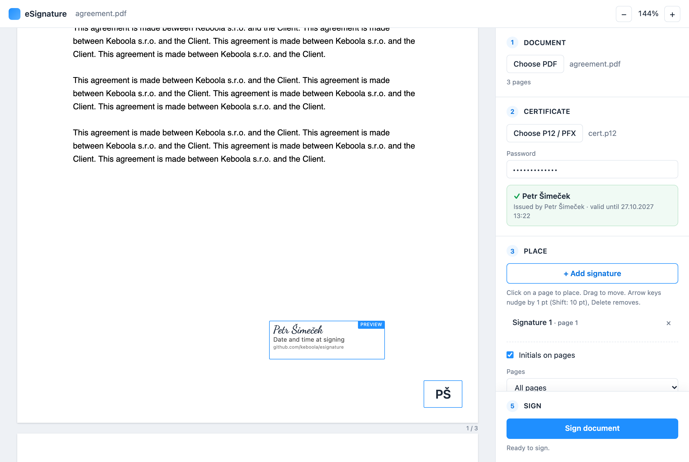

# Keboola eSignature

Sign PDF documents with your own P12/PFX certificate, on your own computer.

eSignature is a small local web app: a PDF-viewer-like editor where you place visible signatures
and initials on the pages, and a signer that adds cryptographically valid PDF signatures
(via pyHanko) behind those marks. Nothing is uploaded anywhere: the app listens on
`127.0.0.1` only, and the document and certificate are held in memory just for the request.



## Features

- **Continuous-scroll viewer** – all pages in one column, rendered lazily by PDF.js; zoom in/out
  or fit to width.
- **Click to place, drag to move** – arm "Add signature", click where it should go, drag it to
  adjust. Arrow keys nudge by 1 pt (Shift: 10 pt), Delete removes it.
- **Multiple signatures** – each visible signature is its own cryptographic signature; all of them
  stay valid.
- **Initials (paraph)** – one shared initials mark in an explicit corner (bottom right or bottom
  left) with margins in points, on all pages, all except the last, or a custom page list. Dragging
  it on any page moves it on every selected page. Pages where it would not fit are listed and
  signing is blocked until fixed.
- **Protocol page** – optional summary page with certificate and signature details.
- **Lock after signing** – the last signature requests that no further changes are made
  (enforcement depends on the PDF viewer).
- **Counter-signing** – add your signature to a contract the other party already signed; their
  signature stays valid (see [Counter-signing signed PDFs](#counter-signing-signed-pdfs)).

## Run it

Requirements: Python 3.11+ and [uv](https://docs.astral.sh/uv/).

```bash
git clone https://github.com/keboola/esignature.git
cd esignature
uv run esignature
```

Then open <http://127.0.0.1:8501>. Stop it with Ctrl+C.

### Configuration

All settings are optional environment variables with safe defaults. An invalid value stops the
app at startup with a message naming the variable.

| Variable | Default | Meaning |
|---|---|---|
| `ESIGN_HOST` | `127.0.0.1` | Bind address; only `127.0.0.1` or `localhost` are accepted |
| `ESIGN_PORT` | `8501` | Port |
| `ESIGN_MAX_PDF_MB` | `50` | Largest PDF accepted |
| `ESIGN_MAX_P12_KB` | `256` | Largest certificate file accepted |
| `ESIGN_MAX_PLACEMENTS` | `1000` | Most signatures + initials in one signing |
| `ESIGN_MAX_IN_FLIGHT` | `2` | Requests handled at once; more get "busy, try again" |
| `ESIGN_BODY_TIMEOUT_S` | `30` | Seconds allowed to upload a request; slower uploads are cut off |
| `ESIGN_MAX_REVISIONS` | `100` | Most revisions (incremental updates) an input PDF may have; each one is analysed when counter-signing |
| `ESIGN_MAX_EXISTING_SIGNATURES` | `20` | Most signatures a document may already have to be counter-signed (each one is validated before and after signing) |

## How to use

1. **Document** – choose a PDF (or drop it onto the page area). It is read once and opened in
   the browser; signing uses exactly those bytes, even if the file changes on disk later.
2. **Certificate** – choose your `.p12`/`.pfx` file and type its password (leave it empty if the
   certificate has none). The app checks it and shows the name, issuer and validity.
3. **Options** – add a protocol page and/or lock the PDF.
4. **Place** – click "Add signature", then click on a page. Drag the box to fine-tune it, or
   select it and use the arrow keys. Turn on "Initials on pages" for a paraph on each page.
   The boxes show a preview; the real mark contains your name, the signing time and a link.
5. **Sign** – click "Sign document", then "Download signed PDF".

Encrypted PDFs and pages with a /Rotate that is not a multiple of 90 degrees are rejected with a
clear message.

## Counter-signing signed PDFs

If the PDF is already signed (for example a contract you received signed by the other party), you
can add your own signature(s) and every earlier signature stays valid:

1. Open the PDF and place your signature(s) as usual. If the document contains signature fields,
   the editor says so (the browser cannot tell whether they are filled, so it does not block
   anything yet).
2. Click **Sign**. The app checks the document. If it is already signed, the editor switches to
   *signed mode*: the protocol page and initials are switched off, your placements are kept, and
   you click **Sign** again to add your signature.
3. Download the result. It is the original file byte for byte, with your signature(s) appended as
   incremental updates.

Why initials and the protocol page are not available: both change page content or add pages,
which an existing signature does not allow. Your full signatures are added as new signature
fields whose appearance is your mark, which approval signatures permit.

**What cannot be counter-signed, in plain words:**

- **Documents certified by another tool.** Many e-signature services (for example DocuSign or
  Adobe Sign completion certificates) *certify* the final document. A certification states which
  changes are allowed afterwards, and standard validators report a newly added visible signature
  as a disallowed change. Adding yours would make their seal look broken, so the app refuses.
- **Signed documents that were re-saved or edited after signing** (for example "Save as" in a
  viewer, or a tool that re-writes the whole file). The original signature then no longer matches
  the file, or the file contains changes the signature does not allow. Ask the sender for the
  original signed file; if the earlier signatures do not need to stay valid, print the document to
  a new PDF and sign that.

Documents that cannot be counter-signed safely are refused with a specific message:

- **Certified or locked** – certified documents (any DocMDP permission), approval signatures
  with a `/Lock` permission, and signatures whose field lock (FieldMDP) covers new fields. Adding
  a visible signature would be reported as a disallowed change by standard validators.
- **Existing signatures not intact** – an earlier signature is already broken, the document was
  changed after signing in a way the signature does not permit (page content, appearance,
  rotation), or a signature was removed or replaced by another one under the same field name.
- **Signature that cannot be checked** – an unsupported signature format (`/SubFilter`).
- **Damaged PDF that may contain signatures** – a file that only parses after repair is repaired
  and signed only if its raw bytes show no sign of a signature (signature names, even written with
  `#xx` escapes) and no compressed object streams, which could hide one. Otherwise repairing it
  could break a signature, so it is refused; re-save it with another PDF tool first.
- **Too many signatures or revisions** – more than `ESIGN_MAX_EXISTING_SIGNATURES` signatures, or
  more than `ESIGN_MAX_REVISIONS` revisions (this limit applies to every input, signed or not).

Document timestamps are kept valid like signatures. After signing, the app re-validates every
original signature and refuses to return a file in which any of them would be broken.

Limits: the app checks that existing signatures are intact and unchanged, not that their
certificates are trusted – that remains the reader's validator's job. Your new mark is opaque, so
a placement that overlaps an existing signature is flagged with a warning; signing is still
allowed.

## Security notes

- Listens on loopback only and rejects requests whose `Host` header is not `127.0.0.1` or
  `localhost` (protects against DNS rebinding).
- Every API call must come from the app's own page: the exact `Origin` and a random per-launch
  token (embedded in the page) are required; there is no CORS.
- Upload size is capped while the body streams in, uploads are kept in memory (never written to a
  temporary file), and only a few requests are admitted at a time.
- All PDF and certificate work runs on a single worker thread.
- Responses are `Cache-Control: no-store` with a strict Content-Security-Policy; certificate and
  file names are always shown as plain text.
- No request bodies, passwords or documents are logged or stored. This is "no persistence by the
  app", not secure memory erasure: Python and browser memory or OS swap are outside its control.
- PDF.js (5.7.284) is vendored under `static/vendor/pdfjs/`, so the editor works fully offline.

## Development

```bash
uv sync
uv run playwright install chromium   # once, for the browser tests
uv run pytest                        # signer, API and browser end-to-end tests
uv run ruff check
```

Project layout:

```
server.py      FastAPI app: security middleware, admission, API, static files, entry point
config.py      Settings from environment variables
signer.py      Signing (pyHanko + PyMuPDF): marks, protocol page, signatures, lock, counter-signing checks
geometry.py    Placement contract and page-space conversion
static/        Frontend: index.html, app.css, js/ (ES modules), vendor/pdfjs/
fonts/         Dancing Script (signature font, OFL)
tests/         pytest suite; tests/e2e/ drives the real app in Chromium
```

### Placement contract

A placement is `{page, type: "signature" | "initials", x, y}`: `page` is 0-based and `x`/`y` are
the top-left corner of the box in PDF points on the page **as displayed** (crop box, rotation
applied, origin top-left), which is exactly PDF.js's viewport at scale 1. Box sizes are fixed:
signature 150 × 50 pt, initials 50 × 35 pt. The server converts this once to PDF coordinates, for
both the initials drawn into the page and the signature field (whose widget appearance is the
signature mark, counter-rotated for the page /Rotate so it is upright as displayed).

## License

MIT for the application. Dancing Script font: SIL Open Font License 1.1 (Pablo Impallari).
PDF.js: Apache License 2.0 (`static/vendor/pdfjs/LICENSE`).
